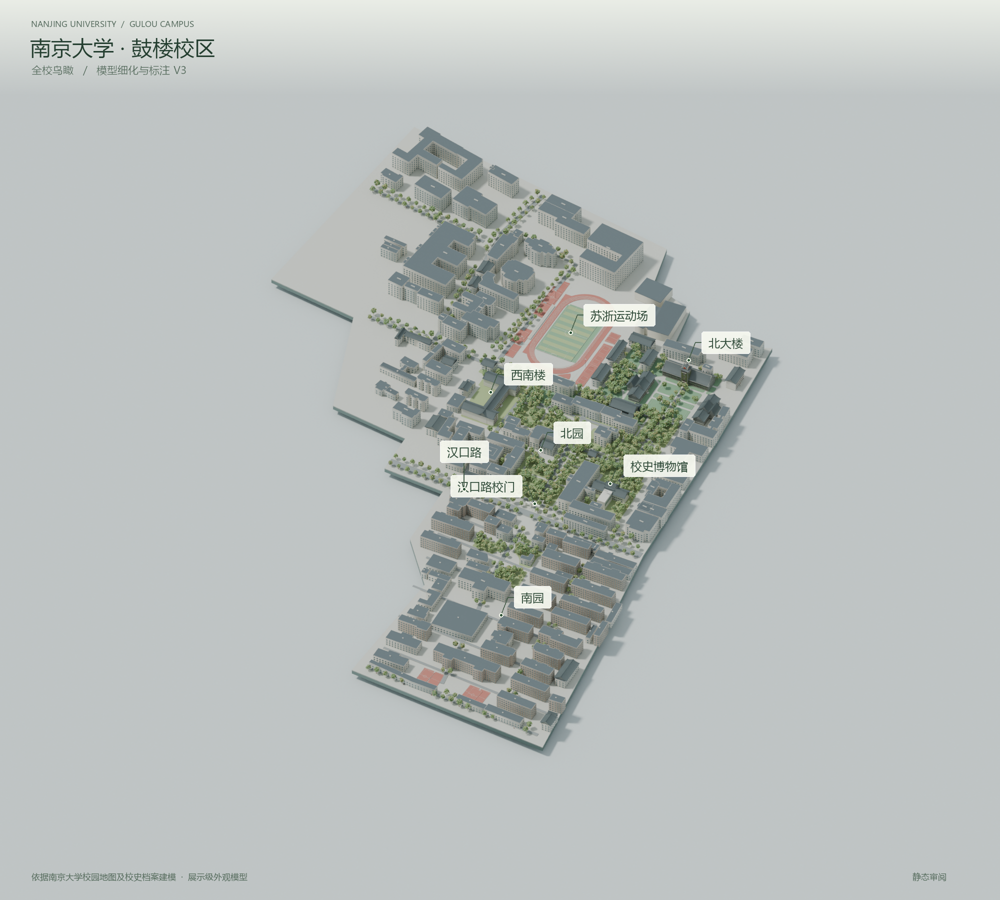
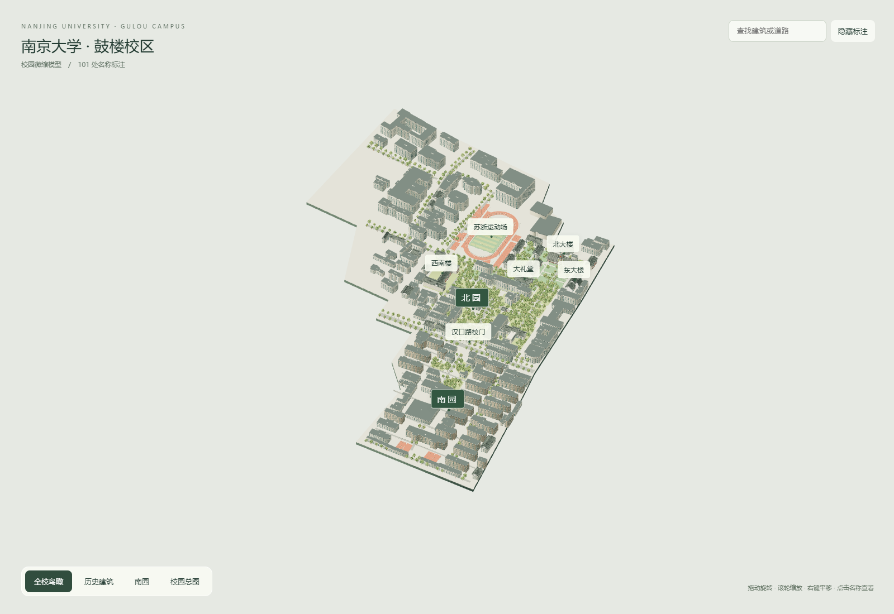

# NJU Gulou Campus

南京大学鼓楼校区的开源展示级三维重建项目。

> An open-source Blender 3D model of Nanjing University’s Gulou Campus, with editable scenes, GLB export, an offline viewer, procedural modeling scripts, and visual references.



## 项目内容

- 可编辑 Blender 场景与重点建筑外观细化
- GLB 通用模型导出
- 无需联网的 HTML 交互查看器
- 程序化建模、标注、导出和验证脚本
- 静态审阅图与视频预览

这是一个依据地图、校史档案和校园照片制作的展示级模型，不是官方数字孪生、测绘成果或产权边界数据。

## 下载完整资产

完整 Blender 工程、GLB 模型、离线查看器和视频预览不放在普通 Git 历史中，请从 [Releases](https://github.com/ZhouYinLong-lab/NJU_GuLou_Campus/releases) 下载。

首个版本：[`v3.0.0`](https://github.com/ZhouYinLong-lab/NJU_GuLou_Campus/releases/tag/v3.0.0)

完整包包含：

- `NJU_Gulou_Campus_V3.blend`：主编辑工程
- `NJU_Gulou_V3_Film.blend`：视频渲染准备场景
- `NJU_Gulou_Campus_V3.glb`：通用三维交换文件
- `NJU_Gulou_Viewer.html`：离线交互查看器
- `NJU_Gulou_V3_Film.mp4`：展示视频预览



## 快速开始

### 只查看模型

从 Release 下载完整包，解压后用桌面版 Chrome 或 Edge 打开 `02_通用模型/NJU_Gulou_Viewer.html`。

### 编辑模型

使用 Blender 4.5.3 或更新版本打开 `01_Blender工程/NJU_Gulou_Campus_V3.blend`。建议先保存为自己的工作副本。

### 运行脚本

源码保留了原始的相对目录约定，脚本位于 `src/outputs`，辅助数据位于 `src/work`。脚本主要用于记录和复现处理过程，最终可编辑成果以 Release 中的 `.blend` 文件为准。

```powershell
blender --background src/outputs/NJU_Gulou_Campus_V3.blend --python src/outputs/export_validate.py
```

完整的 V3 场景重建还需要 Release 中的基础 Blender 工程和本机 Blender 4.5.3 环境。

## 仓库结构

```text
docs/       建模方法、精度范围、参考资料和发布说明
src/        建模、导出、验证脚本及其运行所需数据
previews/   小型预览图
```

## 建模范围与精度

北大楼、东大楼、西大楼、大礼堂、校史博物馆（原金陵大学图书馆）、小礼堂、西南楼和东北楼进行了独立外观细化。普通建筑、植被、道路和部分小设施采用简化或展示性表达。

模型没有进行摄影测量、现场测绘或逐窗核验；没有室内、地下空间和逐瓦级纹理。展示底座不能作为校园产权或测绘边界使用。详细说明见 [`docs/accuracy-and-limitations.md`](docs/accuracy-and-limitations.md)。

## 参考资料

来源链接、引用方式和第三方素材说明见 [`NOTICE.md`](NOTICE.md) 与 [`docs/references.md`](docs/references.md)。仓库不重新分发没有明确再分发许可的原始照片或地图文件。

## 许可证

- 建模脚本、查看器源码和仓库中的代码：MIT，见 [`LICENSE`](LICENSE)。
- 由本项目作者制作的模型、渲染图和视频：CC BY 4.0，见 [`LICENSE-MODEL.md`](LICENSE-MODEL.md)。使用时请署名并注明修改。
- 第三方资料仍受其原始权利和许可约束。

## 引用

如果本项目用于研究、教学、展示或衍生作品，请参考 [`CITATION.cff`](CITATION.cff)，并保留项目链接与作者署名。

